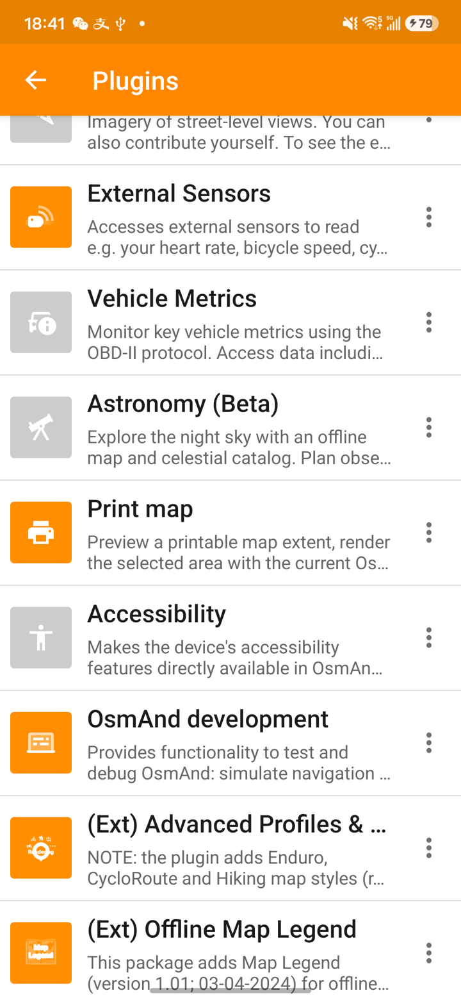
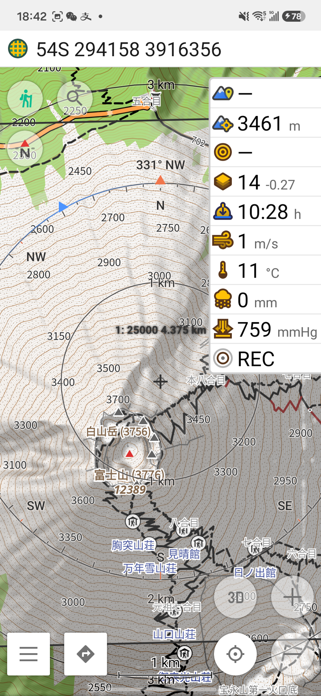
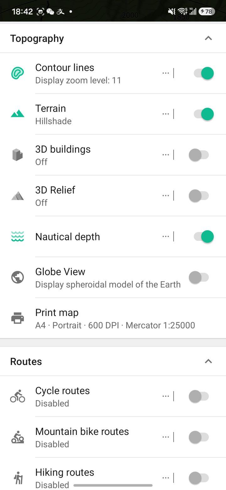
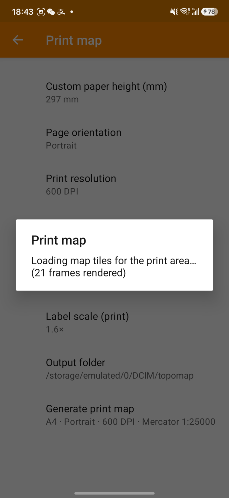
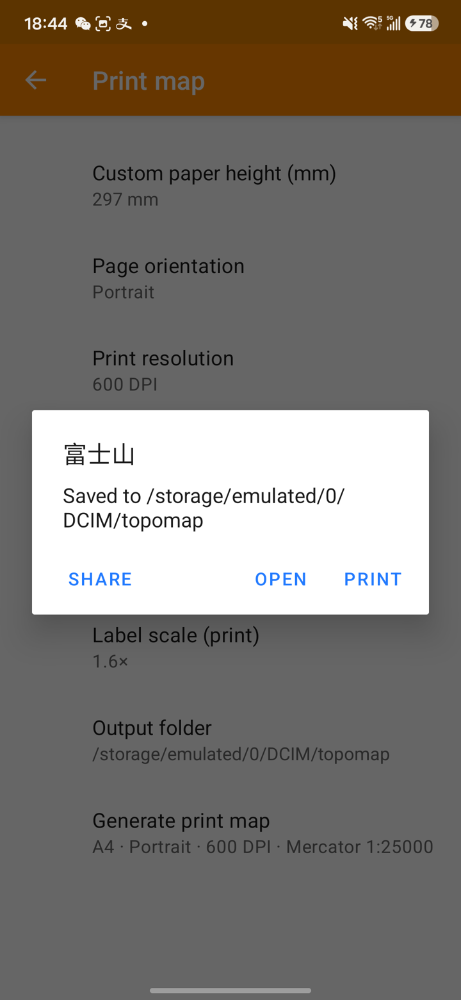

# OsmAnd TopoPrint plugin (Print map)

Turn OsmAnd into a 1:25000 topographic map printer: frame an area on the
map, render it offscreen with the current OsmAnd style, and export a
print-ready map with a true UTM grid, scale bar and declination
(SVG/PNG) — or print it straight from the app.

This branch (`osmand_plugin`) holds the plugin's canonical sources. It is
consumed by the OsmAnd 5.4 workspace as a git submodule
(`plugins/Osmand-TopoPrintPlugin`).

## Setting up the build environment

1. **JDK 17**:

   ```bash
   sudo apt install openjdk-17-jdk        # Debian/Ubuntu
   ```

2. **Android SDK** (command-line tools are enough):

   ```bash
   mkdir -p ~/android-sdk/cmdline-tools
   # Download commandlinetools-linux-*.zip from developer.android.com and
   # unzip it into ~/android-sdk/cmdline-tools/latest, then:
   yes | sdkmanager --sdk_root=$HOME/android-sdk \
     "platforms;android-35" "build-tools;35.0.0" "platform-tools"
   ```

## Building the APK

1. **Clone the OsmAnd workspace with this plugin wired in**:

   ```bash
   git clone https://github.com/acui/OsmAnd.git
   cd OsmAnd
   git checkout topoprint-5.4.11
   git submodule update --init --remote plugins/Osmand-TopoPrintPlugin
   echo "sdk.dir=$HOME/android-sdk" >> local.properties
   ```

2. Create a signing key (once):

   ```bash
   keytool -genkeypair -v -keystore ~/keys/topo_release.keystore \
     -alias topo -keyalg RSA -keysize 2048 -validity 10000
   ```

3. Save this as `build_54_release.sh` in the workspace root (adjust the
   two paths to your layout):

   ```bash
   #!/bin/bash
   # Build the arm64 RELEASE apk, signing with the Topo keystore.
   # Prompts for the keystore password in this shell (hidden input,
   # held in memory only, never written to disk or the build log).
   cd <OSMAND_WORKSPACE>                     # e.g. ~/projects/OsmAnd
   read -s -p "Topo keystore password (alias 'topo'): " TOPO_KEY_PASSWORD
   echo
   export TOPO_KEY_PASSWORD
   export JAVA_HOME=$(ls -d <JDK17_HOME>)    # e.g. /usr/lib/jvm/jdk-17
   ./gradlew :OsmAnd:assembleAndroidFullOpenglArm64Release -x test --no-daemon \
     > /tmp/gradle_54_arm64.log 2>&1
   unset TOPO_KEY_PASSWORD
   tail -2 /tmp/gradle_54_arm64.log
   grep -E "^e: |error: " /tmp/gradle_54_arm64.log | head -15
   ls -lh OsmAnd/build/outputs/apk/androidFullOpenglArm64/release/*.apk 2>/dev/null
   ```

   Under the hood the password is passed to `signingConfigs.topo` via the
   `TOPO_KEY_PASSWORD` environment variable (a
   `~/keys/topo-release-signing.properties` file works too; with neither
   present the build falls back to the debug keystore).

4. Build (prompts for the keystore password):

   ```bash
   bash build_54_release.sh
   # Output: OsmAnd/build/outputs/apk/androidFullOpenglArm64/release/
   #         OsmAnd-androidFull-opengl-arm64-release.apk
   ```

5. Install on a device:

   ```bash
   adb install -r OsmAnd/build/outputs/apk/androidFullOpenglArm64/release/\
   OsmAnd-androidFull-opengl-arm64-release.apk
   ```

> Fast devices handle 600 DPI; on ~3.5 GB RAM devices prefer 300 DPI
> (the 600 dpi tile set is large and memory pressure can drop
> top/left tiles on the slowest hardware).

## Usage

1. **Enable the plugin**: OsmAnd menu → Plugins → **Print map**.

   

2. **Frame the extent**: pan/zoom the map — the UTM coordinates in the
   top bar are the sheet centre.

   

3. **Configure map → Print map**:
   - Paper size (A4/A3/custom 50–3000 mm) and orientation
   - Print resolution (300/600 DPI)
   - Map scale (1:25000 …)
   - Projection (Spherical / Mercator)
   - Label scale (print-only text scaling)
   - Output folder (app-private by default, or a SAF-granted shared
     folder such as `DCIM/topomap`)

   

4. **Generate print map** → type a title (the suggested UTM title comes
   pre-selected) → EXPORT:
   - The progress dialog reports each stage — context preparation, GL
     renderer creation, tile loading (with rendered-frame count), frame
     settling, composition, rasterization
   - If same-named files already exist you are asked before they are
     overwritten

   

5. Done: **SHARE / OPEN / PRINT** buttons act on the PNG; the SVG is
   self-contained (basemap embedded) and can be rasterized or edited on
   a PC.

   

## Sample output

[samples/](samples/) contains a Mount Fuji sheet generated on-device
(Galaxy S25, arm64 · A4 · Portrait · 600 DPI · Mercator 1:25000):

- [fuji_600dpi_A4_25K_portrait.png](samples/fuji_600dpi_A4_25K_portrait.png) —
  finished bitmap, 4961×7016 px
- [fuji_600dpi_A4_25K_portrait.svg](samples/fuji_600dpi_A4_25K_portrait.svg) —
  self-contained vector version (basemap embedded as base64; opens in a
  browser or Inkscape)
