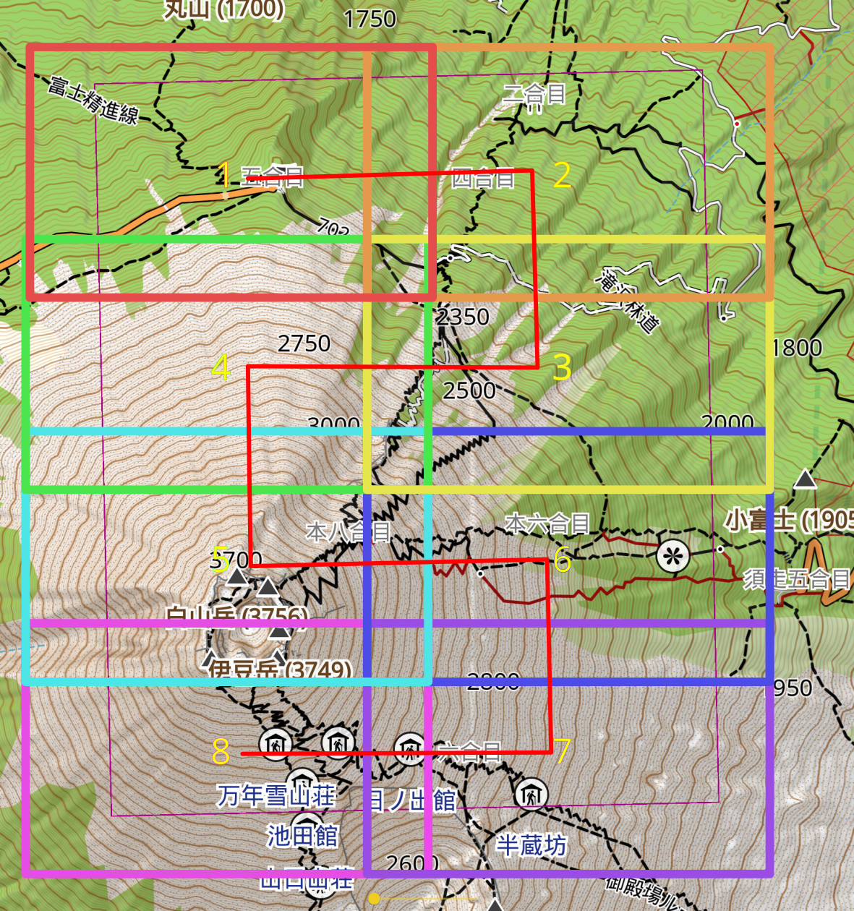
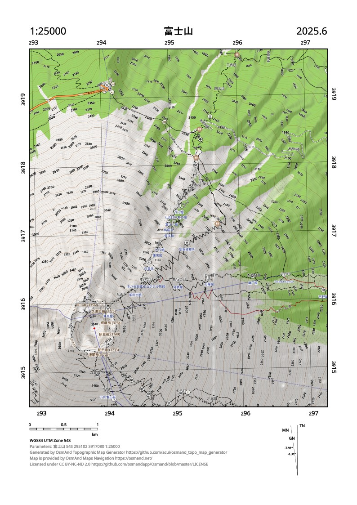

# Printable Map from OsmAnd

This is a tool to generate a printable topographic map from OsmAnd (https://osmand.net) data. The map uses the UTM grid and has declination information. It's to be used with a compass or a GPS device with UTM coordinates.

Two rendering modes are available:

- **render** (default): offline rendering directly from OsmAnd `.obf` map data with a Python implementation of the OsmAnd rendering style (`render.xml`). No emulator or screenshots needed.
- **core**: rendering through the **native OsmAnd engine** (osmandapp/OsmAnd-core, the same C++/Skia renderer the phone app uses), driven off-screen by the `EyePiece` tool. Pixel-identical to the app, including hillshade-ready styling. Requires a one-time build of `~/projects/osmand-native` (see below).
- **screenshots**: the legacy pipeline that stitches screenshots taken in OsmAnd (BlueStacks5 / Waydroid).

## Installation

Tested on Python 3.11

- Put the WMM/WMMHR Coefficient file download from https://www.ncei.noaa.gov/products/world-magnetic-model-high-resolution to the `wmm` directory.
- Install the requirements:
  ```shell
  pip install -r requirements.txt
  ```
- For the offline render mode, provide OsmAnd map data (`.obf` files) and a CJK-capable font (e.g. Noto Sans CJK, auto-detected).

### Getting the .obf data from Waydroid

The OsmAnd data files live inside the Waydroid Android storage:

```shell
# find the data directory (one of the two usually exists)
sudo ls /var/lib/waydroid/data/media/0/Android/data/net.osmand.plus/files/
ls ~/.local/share/waydroid/data 2>/dev/null

# copy the .obf files out (map + srtm contour files)
mkdir -p ~/osmand-data
sudo cp /var/lib/waydroid/data/media/0/Android/data/net.osmand.plus/files/*.obf ~/osmand-data/
sudo cp /var/lib/waydroid/data/media/0/Android/data/net.osmand.plus/files/srtm/*.obf ~/osmand-data/srtm/ 2>/dev/null
sudo chown -R $USER:$USER ~/osmand-data
```

If `/var/lib/waydroid/data` does not exist, your Waydroid keeps userdata in an ext4 image — check `grep mount.entry /var/lib/waydroid/lxc/waydroid/config` and mount it read-only:

```shell
sudo mkdir -p /mnt/wd && sudo mount -o ro,loop <image path> /mnt/wd
sudo find /mnt/wd -name "*.obf"
```

## Usage (offline render mode)

```shell
python topo_map_generator.py 七王坟-凉水背 50T 420500 4437185 1:25000 topomaps/七王坟-凉水背
```

### Native OsmAnd engine mode (`--mode core`)

Renders through the real OsmAnd C++ engine. One-time setup:

```shell
git clone --depth 1 https://github.com/osmandapp/OsmAnd-core.git ~/projects/osmand-native/core
git clone --depth 1 https://github.com/osmandapp/OsmAnd-tools.git ~/projects/osmand-native/tools
git clone --depth 1 https://github.com/osmandapp/OsmAnd-core-legacy.git ~/projects/osmand-native/core-legacy
git clone --depth 1 https://github.com/osmandapp/OsmAnd-resources.git ~/projects/osmand-native/OsmAnd-resources
sudo apt-get install -y qtbase5-dev libgl1-mesa-dev libegl1-mesa-dev
cd ~/projects/osmand-native && cmake -B build -G Ninja -DCMAKE_BUILD_TYPE=Release \
    -DPython3_EXECUTABLE=$(which python3) && ninja -C build eyepiece OsmAndCore_ResourcesBundle_shared
```

(If you already have the repos elsewhere, symlink them into `~/projects/osmand-native/{core,tools/core-legacy,...}` accordingly; a ready-made top-level `CMakeLists.txt` with the required legacy variables and GCC-15 fixes is part of this repository's tooling history.)

Then simply add `--mode core`:

```shell
python topo_map_generator.py 七王坟-凉水背 50T 420500 4437185 1:25000 topomaps/七王坟-凉水背 --mode core
```

Notes:
- Contour lines: for China, OsmAnd's Beijing-area contours ship inside `srtm/China_hebei_asia.srtm.obf` (the standalone `srtmf` file crashes the engine when mixed with map files — currently filtered by the bbox pre-check).
- The engine occasionally crashes during shutdown, after the image has been written; the pipeline tolerates this.

Useful options:

- `--obf_dir ~/osmand-data` — directory with the `.obf` files (map files at the top level, contour files in `srtm/` or `srtmf/` sub-directories)
- `--map_language {local,user,bilingual}` — label language; `--user_lang zh` selects the user language (default `zh`)
- `--dpi 300` — basemap resolution (default 300)
- `--contour_lines {disabled,16,15,14,13,12,11}` — minimum zoom to draw contour lines (default `13`)
- `--contour_width {thin,medium,thick}`, `--contour_color_scheme brown` — contour appearance
- `--render_style`, `--style_addon` — custom rendering styles (defaults: `styles/default.render.xml` + `styles/contourlines.addon.render.xml`, same files OsmAnd uses)
- `--stroke_scale`, `--text_scale` — global line width / label size multipliers
- `--paper_size A4 --orientation portrait|landscape`

The result is `<name>.svg` plus the rendered basemap `<name>_render.png` in the output directory.

## Usage (legacy screenshot mode)

```shell
python topo_map_generator.py --mode screenshots --paper_size A4 --orientation portrait 富士山 54S 295102 3917080 1:25000 topomaps/富士山
```

It will generate a GPX file to the `topomaps/富士山`.

Then import the `富士山.gpx` file into OsmAnd and take screenshots that overlapping and cover the whole region. The screenshots should be taken by using the arrow keys to follow a zigzag pattern.


Copy the screenshots to the `topomaps/富士山`. The program will merge all the screenshots and find 4 corners of the region. You could correct it and let the program generate the final map for you.

Example result:



## Known Issues

- Can not generate a map when the equator is in the region.
- Metric units only.

## License

The source in this repository falls under an MIT license (see LICENSE)